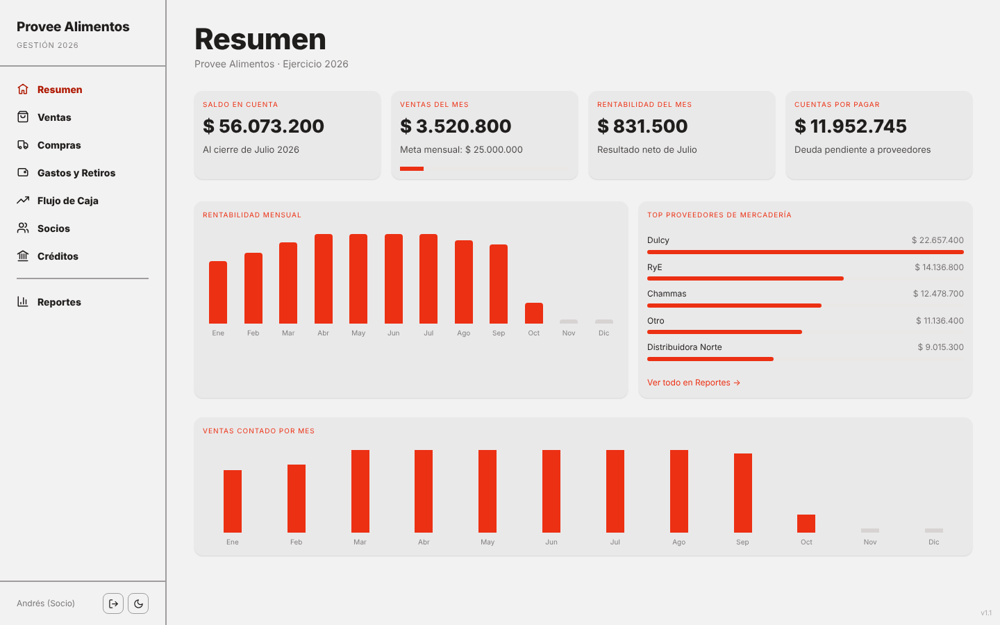
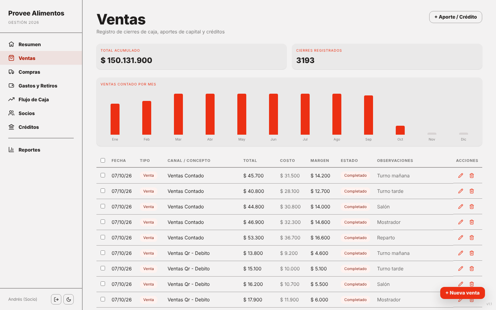
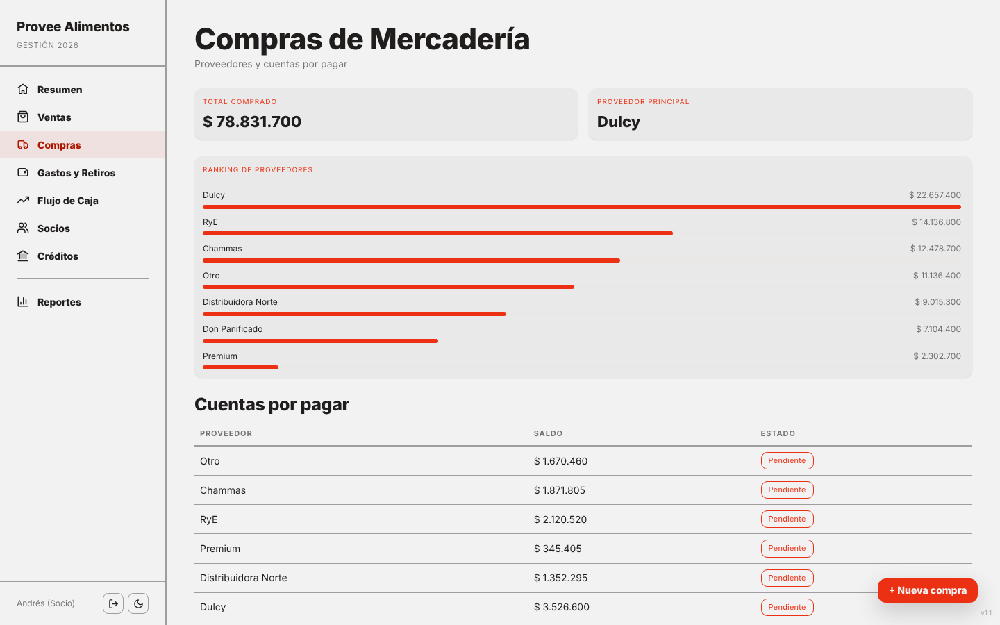
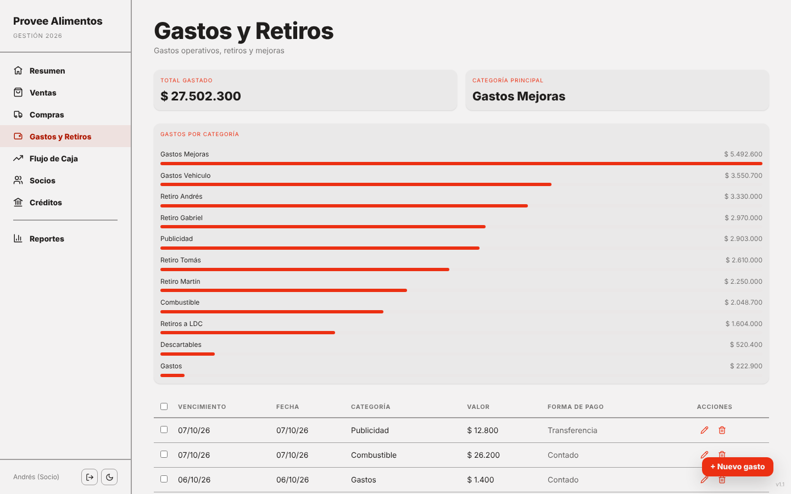
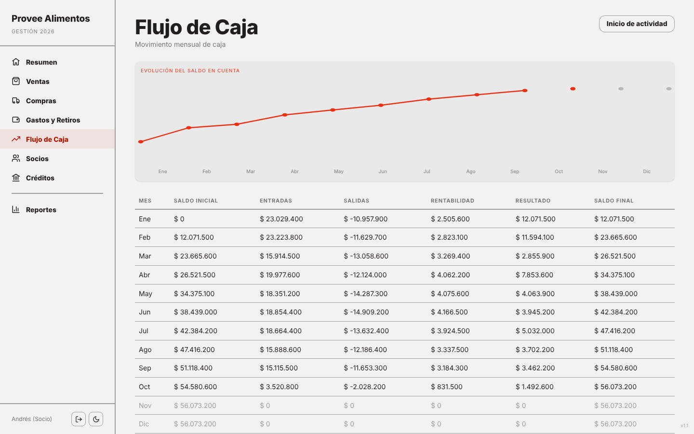
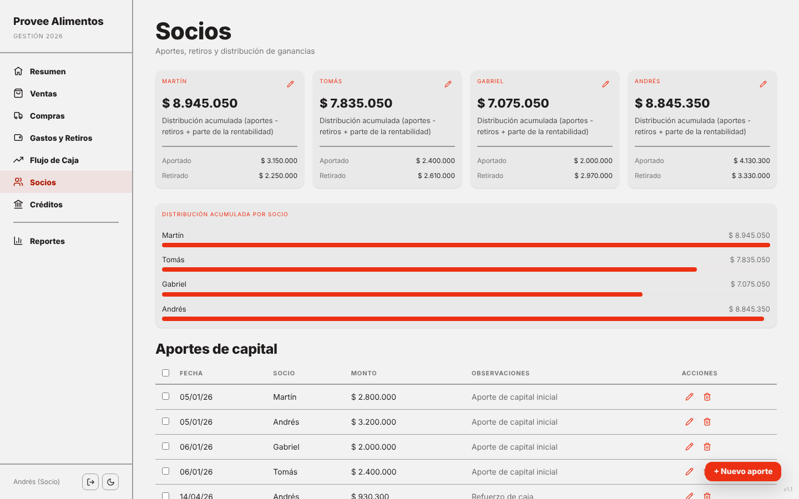
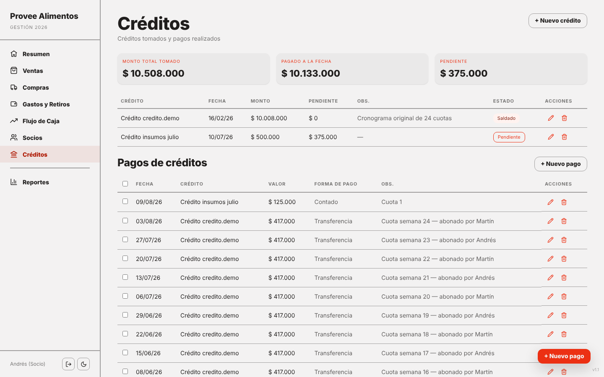
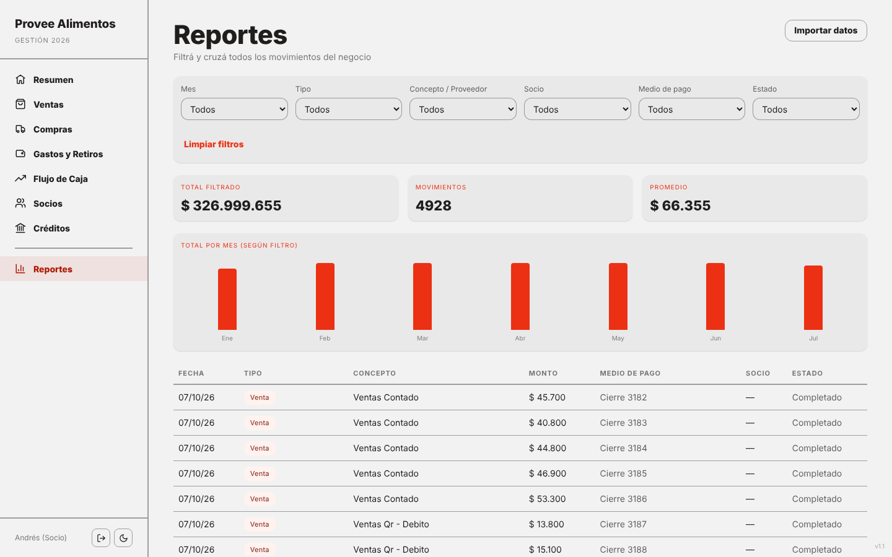
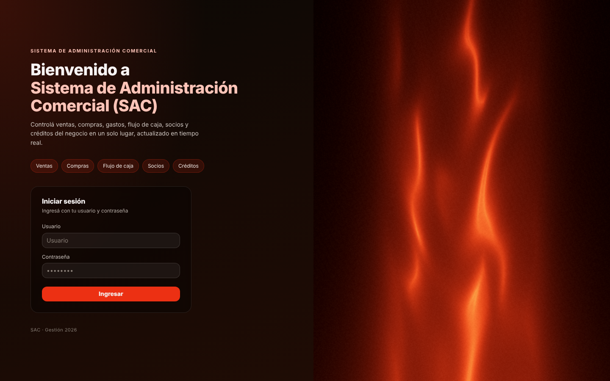

# SAC: Commercial Administration System for a Food Distributor

**Business management web app for small and mid-size companies: sales, purchases, expenses, cash flow, partners' capital and loans, with financial KPIs, charts and reports. Built as a Progressive Web App with a React runtime, an Express static server and an in-browser mock API, so it runs with no backend and no database.**

> Resumen en español: Sistema de Administración Comercial (SAC) para una distribuidora de alimentos. Ventas, compras, gastos y retiros, flujo de caja, socios, créditos y reportes. Esta versión es una demo con datos simulados que viven en memoria.

---

## Demo

| Executive summary | Sales | Purchases |
|---|---|---|
|  |  |  |

| Expenses and withdrawals | Cash flow | Partners |
|---|---|---|
|  |  |  |

| Loans | Reports | Login |
|---|---|---|
|  |  |  |

---

## Key Features

- **Executive summary:** account balance, monthly sales vs. target, monthly profitability, accounts payable, top suppliers and monthly charts.
- **Sales:** daily cash closes by channel (cash, bank transfer, QR / debit), cost of goods, margin, status, refunds and credit notes.
- **Purchases:** merchandise purchases by supplier, payment method, due dates and outstanding debt per supplier.
- **Expenses and withdrawals:** operating categories (supplies, fuel, vehicle, marketing, improvements) and partner withdrawals.
- **Cash flow:** supplier payments and net cash position over time.
- **Partners:** capital contributions, withdrawals and accumulated profit distribution per partner.
- **Loans:** loan disbursements and weekly installments with remaining balance.
- **Reports and import:** filterable reports, CSV import with template download and bulk delete.
- **Mobile-first behavior:** bottom navigation, swipeable KPI cards, light / dark theme.
- **PWA:** installable, service worker with versioned app-shell cache and web manifest.

---

## Key Technical Highlights

### 1 · A backend replaced by a single script

`public/demo-api.js` overrides `window.fetch` for every `/api/*` call the app makes. The client code does not know it is talking to a mock: login, data load, save and backup behave like a real HTTP API, including `401` responses when there is no session.

```javascript
window.fetch = function (url, opts) {
  const path = new URL(url, location.origin).pathname;
  if (!path.startsWith('/api/')) return realFetch(url, opts);
  return wait(180 + Math.random() * 220).then(() => {
    if (path === '/api/login' && method === 'POST') { session = true; return json(200, { ok: true }); }
    if (!session) return json(401, { error: 'Unauthenticated' });
    if (path === '/api/data' && method === 'GET')  return json(200, store);
    if (path === '/api/data' && method === 'PUT')  { store = JSON.parse(opts.body); return json(200, { ok: true }); }
  });
};
```

### 2 · Deterministic, realistic financial dataset

A seeded pseudo-random generator builds a full fiscal year: daily sales per channel split into shifts (about 3,000 records), purchases from seven suppliers, supplier payments covering around 85% of what was bought (so a realistic outstanding debt remains), recurring partner withdrawals, capital contributions and loan installments. The result is the same on every load, which keeps demos and screenshots reproducible.

```javascript
let seed = 20260705;
function rnd() { seed = (seed * 1664525 + 1013904223) % 4294967296; return seed / 4294967296; }
```

### 3 · Excel-style serial dates and client-side aggregation

Dates are stored as spreadsheet serial numbers, and every KPI (monthly profitability, accounts payable, partner distribution) is computed in the browser from the raw records, so editing any row updates all dashboards instantly.

### 4 · Offline-friendly shell

The service worker caches the app shell under a versioned key (`pa-shell-demo-v4`) and serves it when the network is unavailable.

---

## Architecture

```
Browser (PWA)
  |
  |-- public/index.html      UI, state, KPI aggregation, charts
  |-- public/support.js      React 18 runtime + template bindings
  |-- public/demo-api.js     fetch interceptor = in-memory REST API
  |-- public/sw.js           service worker (app-shell cache)
  |
Express (server.js)          serves ./public and /healthz only
```

---

## Tech Stack

| Layer | Technology |
|---|---|
| Frontend | HTML5, JavaScript (ES2020), React 18 runtime, Babel Standalone |
| Visuals | Three.js (WebGL shader login background), custom SVG / CSS charts, CSS animations |
| Design system | Custom "modernist" design tokens, light / dark theme |
| Server | Node.js, Express (static assets and health check) |
| PWA | Service Worker, Web App Manifest |
| Data layer (demo) | `fetch` interceptor with seeded in-memory dataset |
| Deployment | Dockerfile, Railway-ready |

---

## Getting Started

```bash
git clone https://github.com/<your-user>/<your-repo>.git
cd <your-repo>
npm install
npm start
```

Open `http://localhost:3000` (or run `PORT=3002 npm start`). An internet connection is needed the first time, because React, Babel and Three.js are loaded from public CDNs.

| Field | Value |
|---|---|
| User | any |
| Password | any |

No environment variables, database or backend are required.

---

## What this solves

Small distribution businesses usually track sales, supplier debt and partners' money in several spreadsheets. SAC puts those flows in one place, shows the real financial position at a glance (balance, margin, debt) and calculates each partner's accumulated share, which makes monthly decisions faster and more transparent.

> Portfolio / demo version: all data is fictional and generated in memory. Reloading the page restores the initial state.

---

## Keywords

JavaScript, React, Node.js, Express, Progressive Web App (PWA), Service Worker, Three.js, WebGL, dashboard, financial dashboard, KPI, cash flow management, accounting and bookkeeping software, sales and purchases management, accounts payable, expense tracking, loan tracking, partner capital management, data visualization, CSV import, responsive web design, dark mode, REST API mocking, Docker.

**Suggested GitHub topics:** `javascript` `react` `nodejs` `express` `pwa` `threejs` `dashboard` `finance` `accounting` `cash-flow` `small-business` `service-worker` `mock-api` `docker` `portfolio`
